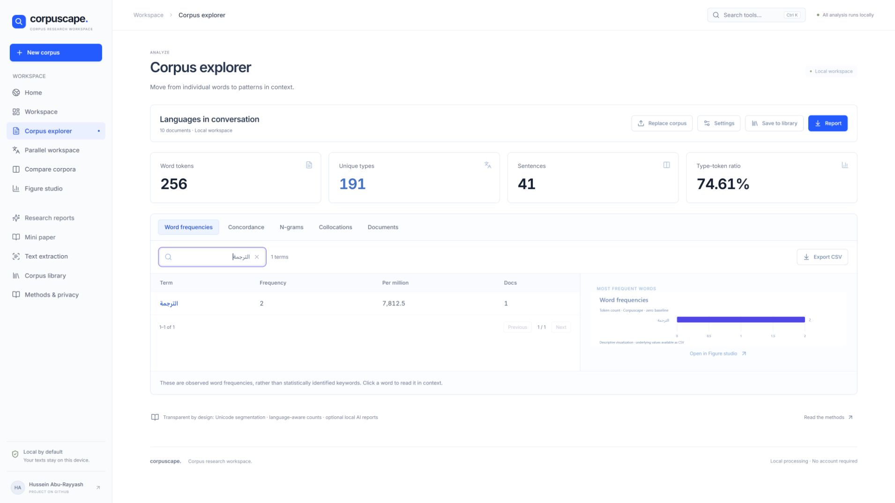

# Corpuscape

Corpuscape is a free browser workspace for multilingual corpus analysis. Explore word frequencies and context, compare corpora, and review parallel texts. It runs without an account or API key. [Open Corpuscape](https://www.corpuscape.com/)

<table>
  <tr>
    <td></td>
    <td></td>
  </tr>
</table>

- Analyze frequencies, concordance lines, n-grams, and collocations across Unicode scripts.
- Compare two corpora and review editable parallel segments with CSV and TMX exports.
- Import documents, tables, and subtitles, or extract text from scans and images with OCR.
- Create figures, statistical reports, and mini papers. Optional local models help draft prose for review.

Imported texts, analyses, and drafts stay on your device. Workspace saves use browser storage. The optional AI and OCR tools download model or language files when requested and process your content locally.

Run locally with Node.js 22.13 or later: `npm ci`, then `npm run dev`.

For citations, use the author and version in [CITATION.cff](CITATION.cff). Corpuscape is available under the [MIT License](LICENSE). See [third-party notices](THIRD_PARTY_NOTICES.txt) for bundled dependencies and adapted design elements.

## Developer notes

`npm test` runs the test suite. `npm run build` checks TypeScript and creates the static site in `dist/`. Use `npm run preview` to check that build locally.

Deploy the contents of `dist/` to a static host. Vercel uses [vercel.json](vercel.json), and `npm run deploy:pages` publishes a built [GitHub Pages mirror](https://husseinaburayyash.github.io/corpuscape/). The canonical site is `https://www.corpuscape.com/`.

See the [changelog](CHANGELOG.md), [2.3 audit](docs/corpus-audit-2.3.md), and [repository maintenance guide](docs/maintenance.md) for release details, verification, and history cleanup.
